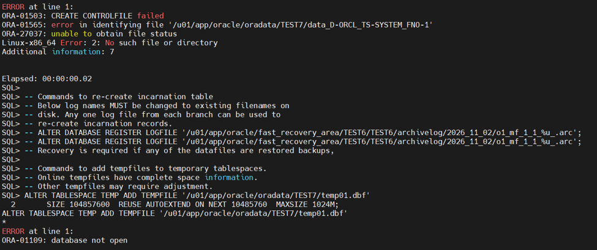
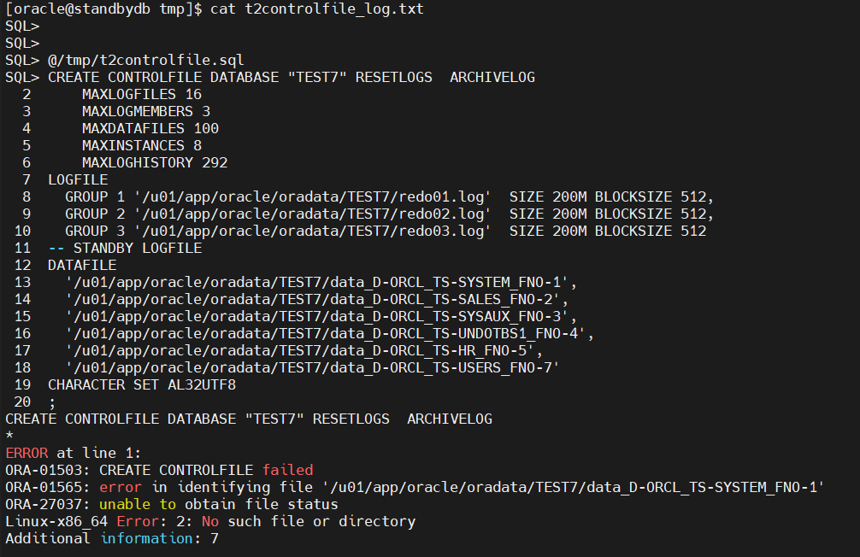

# Oracle Control File Creation Without Physical Datafiles

## 1. Overview

Can an Oracle control file be created before restoring the
physical datafiles?

This lab investigates the behavior of the CREATE CONTROLFILE
statement when the required physical datafiles are not available.

Understanding this dependency is particularly important when
restoring an Oracle database to a different location on the
same server.

## 2. Environment

| Component | Details |
|---|---|
| Operating System | Oracle Linux 8.10 |
| Database Version | Oracle Database 19c |
| Target Instance | TEST7 |
| Database State | NOMOUNT |
| Test Scenario | Control file creation without physical datafiles |
| Tool | SQL*Plus |

## 3. Objectives

- Understand control file creation dependencies.
- Generate and modify a control file trace script.
- Test CREATE CONTROLFILE without physical datafiles.
- Identify and analyze the resulting Oracle errors.
- Understand the difference between CREATE CONTROLFILE and RESTORE CONTROLFILE.

## 4. Generate a Control File Trace Script

A control file trace script can be generated from an existing
database using the following command:

```sql
ALTER DATABASE BACKUP CONTROLFILE
TO TRACE AS '/tmp/ORCL_controlfile.sql';
```

The generated SQL script contains database structure information,
including:

- Database name
- Datafile paths
- Redo log file paths
- Database configuration details
- Character set information

The script can be modified to reflect the target database
name and file locations.

For example:

**Original datafile location:**

```text
/u01/app/oracle/oradata/ORCL/system01.dbf
```

**New datafile location:**

```text
/u01/app/oracle/oradata/TEST7/system01.dbf
```

However, modifying the file paths in the SQL script does not
create or restore the physical datafiles.

## 5. Why Physical Datafiles Are Required

The CREATE CONTROLFILE statement reconstructs a control file
using information from the existing physical database files.

Oracle needs to access the required datafiles and read their
header information.

This information includes:

| Information | Purpose |
|---|---|
| Database identification | Identifies the database associated with the datafile |
| Datafile number | Identifies the file within the database |
| Checkpoint information | Provides information required for recovery |
| Datafile consistency | Helps verify the compatibility of database files |

Although CREATE CONTROLFILE can be executed in NOMOUNT mode,
the required physical datafiles must be available at their
specified locations.

Creating only the directories is not sufficient.

## 6. Practical Test Using TEST7

The following steps were performed to investigate control
file creation without restoring the physical datafiles:

1. Prepared separate directories for TEST7.
2. Prepared the initialization parameter file (PFILE).
3. Started the TEST7 instance in NOMOUNT mode.
4. Modified the control file creation script.
5. Executed the script without restoring the required datafiles.

### Control File Creation Statement

The following statement reflects the CREATE CONTROLFILE
statement used in the recorded TEST7 test.

```sql
CREATE CONTROLFILE DATABASE "TEST7"
RESETLOGS ARCHIVELOG
    MAXLOGFILES 16
    MAXLOGMEMBERS 3
    MAXDATAFILES 100
    MAXINSTANCES 8
    MAXLOGHISTORY 292
LOGFILE
    GROUP 1 '/u01/app/oracle/oradata/TEST7/redo01.log'
        SIZE 200M BLOCKSIZE 512,
    GROUP 2 '/u01/app/oracle/oradata/TEST7/redo02.log'
        SIZE 200M BLOCKSIZE 512,
    GROUP 3 '/u01/app/oracle/oradata/TEST7/redo03.log'
        SIZE 200M BLOCKSIZE 512
DATAFILE
    '/u01/app/oracle/oradata/TEST7/data_D-ORCL_TS-SYSTEM_FNO-1',
    '/u01/app/oracle/oradata/TEST7/data_D-ORCL_TS-SALES_FNO-2',
    '/u01/app/oracle/oradata/TEST7/data_D-ORCL_TS-SYSAUX_FNO-3',
    '/u01/app/oracle/oradata/TEST7/data_D-ORCL_TS-UNDOTBS1_FNO-4',
    '/u01/app/oracle/oradata/TEST7/data_D-ORCL_TS-HR_FNO-5',
    '/u01/app/oracle/oradata/TEST7/data_D-ORCL_TS-USERS_FNO-7'
CHARACTER SET AL32UTF8;
```

The required physical datafiles were intentionally unavailable
during this test.

This statement is included as a record of the failed test,
not as a ready-to-execute recovery script.

## 7. Capturing Execution Logs

SQL*Plus SPOOL was used to capture the script execution
and Oracle error messages.

```sql
SET ECHO ON
SET FEEDBACK ON
SET TIMING ON
SET LINESIZE 200
SET PAGESIZE 100

SPOOL /tmp/t2controlfile_log.txt

@/tmp/t2controlfile.sql

SPOOL OFF
```

The captured log can be reviewed from the Linux terminal.

```bash
cat /tmp/t2controlfile_log.txt
```

Capturing execution logs helps identify errors and investigate
the root cause of failed database operations.

## 8. Actual Error Output

When CREATE CONTROLFILE was executed without the required
physical datafiles, Oracle returned the following errors:

```text
ORA-01503: CREATE CONTROLFILE failed
ORA-01565: error in identifying file
ORA-27037: unable to obtain file status
Linux Error: 2: No such file or directory
```

### Control File Creation Failure



### Captured Execution Log



## 9. Root Cause Analysis

| Error | Explanation |
|---|---|
| ORA-01503 | The CREATE CONTROLFILE operation failed |
| ORA-01565 | Oracle could not identify the specified file |
| ORA-27037 | Oracle could not obtain the file status from the operating system |
| Linux Error 2 | The specified physical file did not exist |

The underlying cause was the absence of the required
physical datafiles at the target locations.

Although the directories and control file SQL script had
been prepared, Oracle could not access the SYSTEM datafile
required for control file creation.

The initial CREATE CONTROLFILE failure also prevented
subsequent operations requiring an open database from
completing successfully.

## 10. CREATE CONTROLFILE vs. RESTORE CONTROLFILE

An alternative approach during an RMAN-based database
restoration is to restore an existing control file backup.

```sql
RESTORE CONTROLFILE FROM '<controlfile_backup_path>';
```

Unlike CREATE CONTROLFILE, RMAN can restore a control file
backup before restoring the physical datafiles.

This allows the database to be mounted and the datafile
restoration process to proceed.

| Feature | CREATE CONTROLFILE | RESTORE CONTROLFILE |
|---|---|---|
| Purpose | Reconstructs a control file | Restores a backed-up control file |
| Tool | SQL*Plus | RMAN |
| Physical datafiles required for the operation | Yes | No |
| Existing control file backup required | No | Yes, for this backup-based method |
| Can be performed in NOMOUNT mode | Yes | Yes |
| Restores missing datafiles | No | No |

These commands serve different purposes and are not
interchangeable.

For a complete example of an RMAN-based database restoration,
refer to the related practical:

[Oracle RMAN Database Restore on the Same Server](../rman-restore-same-server)

## 11. Key Technical Takeaways

- A control file trace script can be generated and modified
  before restoring the physical datafiles.
- Modifying file paths does not create physical datafiles.
- Creating directories alone is not sufficient.
- CREATE CONTROLFILE requires the physical datafiles specified
  in the statement to be available.
- RMAN RESTORE CONTROLFILE can restore a control file before
  the physical datafiles are restored.
- Understanding recovery dependencies helps prevent unnecessary
  errors during database restoration.
- Capturing execution logs is important for database troubleshooting.

## 12. Lab Conclusion

The TEST7 practical demonstrated that CREATE CONTROLFILE
cannot successfully reconstruct the control file when the
required physical datafiles are missing.

The observed Oracle and operating system errors confirmed
the physical datafile dependency.

For backup-based RMAN restoration, restoring an existing
control file backup provides an alternative recovery approach
that does not require the physical datafiles to be present
at the control file restoration stage.

## 13. References

- [Oracle 19c - CREATE CONTROLFILE](https://docs.oracle.com/en/database/oracle/oracle-database/19/sqlrf/CREATE-CONTROLFILE.html)
- [Oracle 19c - ALTER DATABASE](https://docs.oracle.com/en/database/oracle/oracle-database/19/sqlrf/ALTER-DATABASE.html)
- [Oracle 19c - RMAN RESTORE](https://docs.oracle.com/en/database/oracle/oracle-database/19/rcmrf/RESTORE.html)
- [Oracle 19c - Managing Control Files](https://docs.oracle.com/en/database/oracle/oracle-database/19/admin/managing-control-files.html)

