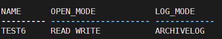
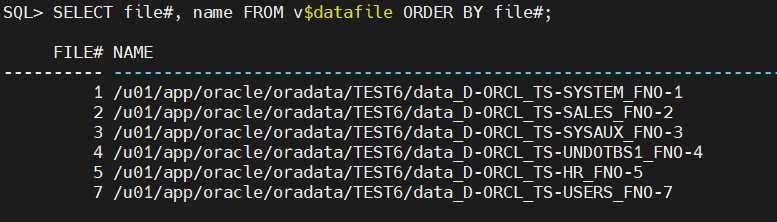
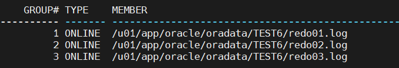
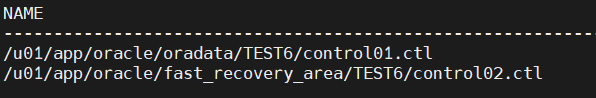
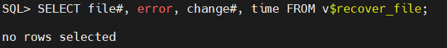

# Oracle RMAN Database Restore on the Same Server

## 1. Overview

This lab demonstrates how to restore an existing Oracle database
(ORCL) as a separate database (TEST6) on the same server using
RMAN backup and recovery, without using the DUPLICATE command.

The main objective is to restore the database to a different
location while protecting the original database.

## 2. Environment

| Component | Details |
|---|---|
| Operating System | Oracle Linux 8.10 |
| Database Version | Oracle Database 19c |
| Source Database | ORCL |
| Target Database | TEST6 |
| Backup Tool | Oracle RMAN |
| Restore Method | Backup-based Restore and Recovery |
| Database Rename Method | Control File Recreation |
| Backup Location | /data/RMAN/backup |

## 3. Objectives

- Restore a database using existing RMAN backups.
- Restore the control file before restoring datafiles.
- Restore datafiles to a separate directory.
- Update database file references in the control file.
- Perform database recovery.
- Manage redo log and tempfile locations.
- Rename the restored database.
- Verify the restored database and its file locations.

## 4. Restore Workflow

1. Prepare separate directories.
2. Configure the target initialization parameter file (PFILE).
3. Start the target instance in NOMOUNT mode.
4. Restore the control file using RMAN.
5. Mount the database.
6. Catalog the backup pieces.
7. Restore and switch datafiles.
8. Perform database recovery.
9. Verify and isolate redo log and tempfile paths.
10. Recreate the control file for database renaming.
11. Complete the required recovery and open the database.
12. Perform post-recovery verification.

## 5. Prepare Database Directories

Create separate directories for the target database.

```bash
mkdir -p /u01/app/oracle/oradata/TEST6
mkdir -p /u01/app/oracle/admin/test6/adump
mkdir -p /u01/app/oracle/fast_recovery_area/TEST6
```

Verify the directories.

```bash
ls -ld /u01/app/oracle/oradata/TEST6
ls -ld /u01/app/oracle/admin/test6/adump
ls -ld /u01/app/oracle/fast_recovery_area/TEST6
```

Separate directories help prevent conflicts with the source
database files.

## 6. Configure the PFILE

Prepare an initialization parameter file for the target instance.

The following parameters are an illustrative configuration.
Memory settings and FRA size must be adjusted for the environment.

```ini
db_name='ORCL'
db_unique_name='TEST6'

control_files='/u01/app/oracle/oradata/TEST6/control01.ctl'

audit_file_dest='/u01/app/oracle/admin/test6/adump'

db_recovery_file_dest='/u01/app/oracle/fast_recovery_area/TEST6'
```

Initially, DB_NAME must match the database name recorded in
the restored control file.

DB_UNIQUE_NAME identifies the target database separately from
the source database.

## 7. Start the Target Instance

Set the target Oracle SID.

```bash
export ORACLE_SID=TEST6
echo $ORACLE_SID

sqlplus / as sysdba
```

Start the instance in NOMOUNT mode.

```sql
STARTUP NOMOUNT PFILE='$ORACLE_HOME/dbs/inittest6.ora';
```

Use the actual absolute PFILE path if the environment variable
is not expanded by SQL*Plus.

Verify the instance.

```sql
SELECT instance_name, status
FROM v$instance;
```

At this stage, the instance is started, but the control file
has not been opened.

## 8. Restore the Control File

Connect to RMAN after verifying the target ORACLE_SID.

```bash
export ORACLE_SID=TEST6

rman target /
```

Restore the control file from an existing backup.

```sql
RESTORE CONTROLFILE FROM
'/data/RMAN/backup/control_c-1768855422-20261015-01';
```

Mount the database.

```sql
ALTER DATABASE MOUNT;
```

The control file contains database structure information and
RMAN repository metadata.

Restoring the control file allows the database to be mounted
before restoring its physical datafiles.

## 9. Catalog the Backup Pieces

```sql
CATALOG START WITH '/data/RMAN/backup/' NOPROMPT;
```

Verify available backups.

```sql
LIST BACKUP SUMMARY;

LIST BACKUP OF ARCHIVELOG ALL;
```

Cataloging registers available backup pieces in the RMAN repository.

## 10. Restore and Recover the Database

Restore datafiles to the TEST6 directory.

```sql
RUN {
    SET NEWNAME FOR DATABASE TO
    '/u01/app/oracle/oradata/TEST6/%U';

    RESTORE DATABASE;
    SWITCH DATAFILE ALL;
    RECOVER DATABASE;
}
```

### Command Explanation

| Command | Purpose |
|---|---|
| SET NEWNAME | Specifies the new datafile locations |
| RESTORE DATABASE | Restores physical datafiles from backups |
| SWITCH DATAFILE ALL | Updates datafile references in the control file |
| RECOVER DATABASE | Applies the redo required for recovery |

The recovery target and required archived redo logs must be
validated before opening the database.

A missing archived log must be investigated rather than
automatically ignored.

## 11. Manage Redo Log Locations

Check the existing redo log paths.

```sql
SELECT group#, type, member
FROM v$logfile
ORDER BY group#, member;
```

Update the redo log references to the target location.

```sql
ALTER DATABASE RENAME FILE
'/u01/app/oracle/oradata/ORCL/redo01.log'
TO
'/u01/app/oracle/oradata/TEST6/redo01.log';

ALTER DATABASE RENAME FILE
'/u01/app/oracle/oradata/ORCL/redo02.log'
TO
'/u01/app/oracle/oradata/TEST6/redo02.log';

ALTER DATABASE RENAME FILE
'/u01/app/oracle/oradata/ORCL/redo03.log'
TO
'/u01/app/oracle/oradata/TEST6/redo03.log';
```

ALTER DATABASE RENAME FILE updates file references.
It does not physically copy or move files.

Redo log references must be isolated from the source database
before opening the restored database with RESETLOGS.

## 12. Manage Temporary Tablespace Files

Verify tempfile references.

```sql
SELECT file#, name, status
FROM v$tempfile;
```

Ensure that the restored database uses its own tempfile locations.

Example command to create a tempfile when the target database
is in the appropriate open state:

```sql
ALTER TABLESPACE TEMP
ADD TEMPFILE
'/u01/app/oracle/oradata/TEST6/temp01.dbf'
SIZE 100M
AUTOEXTEND ON NEXT 10M MAXSIZE 1G;
```

**Safety Warning:** Never delete a physical tempfile belonging
to the source database while configuring the restored database.

## 13. Back Up the Control File Before Renaming

Generate a control file trace script.

```sql
ALTER DATABASE BACKUP CONTROLFILE
TO TRACE AS '/tmp/TEST6_create_controlfile.sql';
```

Create a binary control file backup.

```sql
ALTER DATABASE BACKUP CONTROLFILE
TO '/data/RMAN/backup/TEST6_control_before_rename.ctl';
```

Back up the PFILE.

```bash
cp $ORACLE_HOME/dbs/inittest6.ora \
   $ORACLE_HOME/dbs/inittest6.ora.bak
```

The trace script provides the SQL statements required to
recreate the control file.

## 14. Rename the Restored Database

The original lab used control file recreation to rename
the restored database from ORCL to TEST6.

The process involves:

- Shutting down the target instance.
- Updating DB_NAME in the target PFILE.
- Preparing the control file creation script.
- Starting the target instance in NOMOUNT mode.
- Recreating the control file using SET DATABASE and RESETLOGS.
- Completing any required media recovery.
- Opening the renamed database.

### Updated Database Name

```ini
db_name='TEST6'
db_unique_name='TEST6'
```

### Control File Recreation

The following statement reflects the datafile and redo log
configuration recorded in the TEST6 lab.

```sql
CREATE CONTROLFILE REUSE SET DATABASE "TEST6"
RESETLOGS ARCHIVELOG
    MAXLOGFILES 16
    MAXLOGMEMBERS 3
    MAXDATAFILES 100
    MAXINSTANCES 8
    MAXLOGHISTORY 292
LOGFILE
    GROUP 1 '/u01/app/oracle/oradata/TEST6/redo01.log'
        SIZE 200M BLOCKSIZE 512,
    GROUP 2 '/u01/app/oracle/oradata/TEST6/redo02.log'
        SIZE 200M BLOCKSIZE 512,
    GROUP 3 '/u01/app/oracle/oradata/TEST6/redo03.log'
        SIZE 200M BLOCKSIZE 512
DATAFILE
    '/u01/app/oracle/oradata/TEST6/data_D-ORCL_TS-SYSTEM_FNO-1',
    '/u01/app/oracle/oradata/TEST6/data_D-ORCL_TS-SALES_FNO-2',
    '/u01/app/oracle/oradata/TEST6/data_D-ORCL_TS-SYSAUX_FNO-3',
    '/u01/app/oracle/oradata/TEST6/data_D-ORCL_TS-UNDOTBS1_FNO-4',
    '/u01/app/oracle/oradata/TEST6/data_D-ORCL_TS-HR_FNO-5',
    '/u01/app/oracle/oradata/TEST6/data_D-ORCL_TS-USERS_FNO-7'
CHARACTER SET AL32UTF8;
```

**Important:** All required physical datafiles must exist before
executing CREATE CONTROLFILE.

The file list must be verified against the actual database
structure before recreating the control file.

When media recovery is required after recreating the control
file with RESETLOGS, use the appropriate backup control file
recovery procedure.

For example, in SQL*Plus:

```sql
RECOVER DATABASE USING BACKUP CONTROLFILE UNTIL CANCEL;
```

Supply the required redo logs and confirm that the intended
recovery point has been reached.

Open the database only after the recovery requirements have
been satisfied.

```sql
ALTER DATABASE OPEN RESETLOGS;
```

DBNEWID (NID) is another Oracle-supported option for changing
the database name and DBID.

## 15. Post-Recovery Verification

### Verify Database Status

```sql
SELECT name, open_mode, log_mode
FROM v$database;
```


### Verify Instance Status

```sql
SELECT instance_name, status
FROM v$instance;
```

### Verify Datafile Locations

```sql
SELECT file#, name
FROM v$datafile
ORDER BY file#;
```


### Verify Redo Log Locations

```sql
SELECT group#, member
FROM v$logfile
ORDER BY group#;
```


### Verify Control File Locations

```sql
SELECT name
FROM v$controlfile;
```


### Verify Tempfile Locations

```sql
SELECT file#, name, status
FROM v$tempfile;
```

### Check Files Requiring Recovery

```sql
SELECT file#, error, change#, time
FROM v$recover_file;
```


### Expected Verification Results

- Database name: TEST6
- Instance name: TEST6
- Database open mode: READ WRITE
- Database file references point to the target locations.
- No unexpected files requiring media recovery.
- The source database remains unaffected.

These verification results must be confirmed using the
actual database outputs.

## 16. Key Technical Takeaways

- RESTORE CONTROLFILE can be performed before restoring
  the physical datafiles.
- RESTORE DATABASE restores physical datafiles from backups.
- SWITCH DATAFILE ALL updates file references in the control file.
- RESTORE and RECOVER perform different operations.
- CREATE CONTROLFILE requires existing physical datafiles.
- Database file isolation is essential when restoring on
  the same server.
- Opening a database successfully does not by itself prove
  that all source transactions have been recovered.
- Post-recovery verification is an essential part of
  database restoration.

## 17. Safety Considerations

- Always verify ORACLE_SID before executing administrative commands.
- Use separate control file, datafile, redo log and FRA locations.
- Do not overwrite or delete source database files.
- Confirm backup and archived redo log availability.
- Verify the intended recovery point before OPEN RESETLOGS.
- Verify the DBID before registering the restored database
  in a shared recovery catalog.
- Take a new RMAN backup after completing the restoration
  and database renaming.
- Validate procedures in a non-production environment first.

## 18. Lab Result

The TEST6 lab was completed using an RMAN backup-based
restore and recovery approach followed by control file
recreation for database renaming.

The original lab notes record the final OPEN RESETLOGS command.
The final verification screenshots and detailed recovery logs
are not included in the available source notes.

This documentation is a reviewed lab reference, not an
unattended production recovery script.

## 19. References

- [Oracle 19c - RMAN RESTORE](https://docs.oracle.com/en/database/oracle/oracle-database/19/rcmrf/RESTORE.html)
- [Oracle 19c - Advanced RMAN Recovery](https://docs.oracle.com/en/database/oracle/oracle-database/19/bradv/rman-recovery-advanced.html)
- [Oracle 19c - Managing Control Files](https://docs.oracle.com/en/database/oracle/oracle-database/19/admin/managing-control-files.html)
- [Oracle 19c - User-Managed Recovery](https://docs.oracle.com/en/database/oracle/oracle-database/19/bradv/user-managed-recovery-advanced.html)

